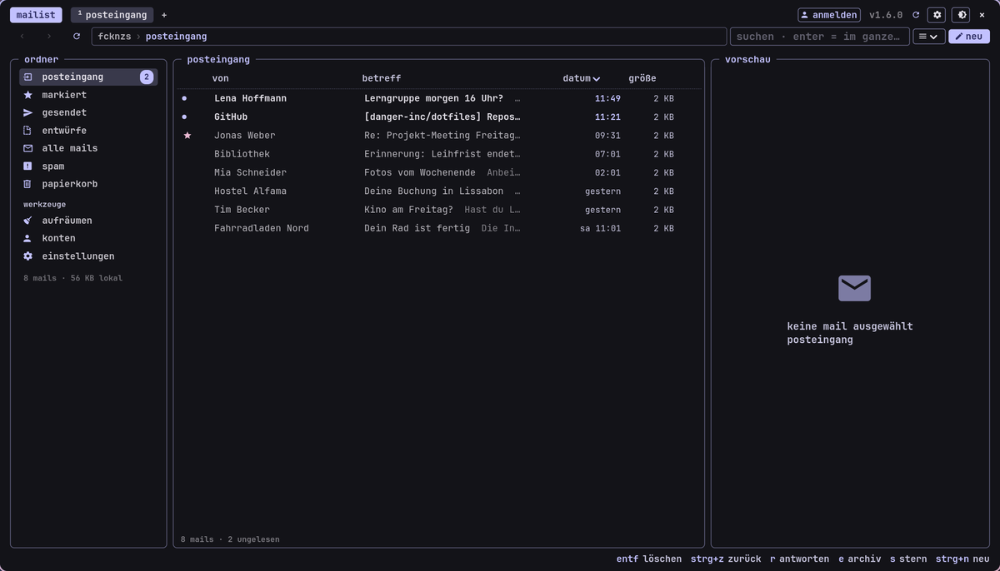

<!-- gh-header -->
<div align="center">


# mailist

**mail program designed to match the -ist suite. lightweight**

   

</div>

<p align="center"></p>

<p align="center"><!-- gh-note --><sub>tip: the glass button (󰃝, top right) makes the window see-through, like the terminal – needs a compositor with blur, e.g. hyprland.</sub></p>

slim mail program (gmail and imap/smtp) in the terminal look of the suite (gtk4), built like a file explorer:
folders and labels on the left, the mail list with columns in the middle, the preview on the right, tabs on top.
mails are kept in a local cache – the window is there instantly and readable offline.

## install – linux

the repository is public – no account needed:

```bash
git clone https://github.com/danger-inc/mailist-public ~/mailist-src
cd ~/mailist-src && ./install.sh
```

the installer asks for the system packages (gtk4, pygobject – password once), copies mailist to
`~/.local/share/mailist` and creates the command `mailist` and a menu entry. the icons are bundled.

## update

```bash
cd ~/mailist-src && ./update.sh
```

## several mailboxes

under **konten** you can add as many mailboxes as you like: more gmail accounts and any mailbox with
imap/smtp (gmx, web.de, outlook, posteo, mailbox.org, icloud are detected from the address, everything else
via server settings). switch in the folder bar at the top or with `ctrl+shift+a`; all of them sync in the
background. passwords go into the system keyring (can be turned off), never into plain text.

## encryption (openpgp)

via the installed `gpg`: **sign** and **encrypt** in the compose window (encrypt switches on by itself
when there is a key for every recipient); when reading, signatures are checked and encrypted mails are
decrypted. create/export/import your own key under **einstellungen**. all
security-related switches (connections, certificates, keyring, openpgp, autocrypt, confirmations for
links/attachments) are in there as well.

## connect gmail (once)

mailist talks to the gmail api directly – through **your own** google access, no third-party server in between.

1. [google cloud console](https://console.cloud.google.com) → create a project → **google auth platform** →
   create a client, type **desktop app** → download the json. Under "audience" add yourself as a test user.
   (if you already set up datist: mailist picks up the same access automatically.)
2. enable the **gmail api** in the same project (mailist has a button for that).
3. in mailist click **konto** on the left → "mit google anmelden". google warns that the app is not verified –
   it is your own access: "continue" and tick the gmail box.

in testing mode google ends the login after 7 days; mailist then shows "⚠ neu anmelden" at the top.

## usage

* **delete:** del (trash), shift+del (permanently), trash button on every row, ctrl+z undoes it.
select several (ctrl/shift-click, ctrl+a) → big buttons for all of them.
* **aufräumen** (left): who sends the most? remove all mails of a sender in one click, unsubscribe from newsletters.
* **search:** typing filters locally right away, enter searches the whole mailbox (on gmail also `from:` `has:attachment` …).
* keys: r reply · a reply all · f forward · e archive · s star · u read/unread · j/k next/previous ·
ctrl+n new · ctrl+t tab · F9 folder bar · F3 preview · F5 sync. two-finger swipe = back/forward.
* drag mails onto a folder on the left = move (trash, spam, label).
* **security:** every mail is checked locally – spf/dkim/dmarc, forged sender names, different reply address,
disguised links (red; the real target is shown at the bottom when you hover), dangerous attachments. external
images and tracking pixels are never loaded.

`mailist --daemon` keeps mailist ready in the background (syncs, notifies about new mails), `mailist --toggle` shows/hides
the window (good for a keybinding), `mailist mailto:…` writes a new mail.

## data

* cache: `~/.cache/mailist/mail.db` (just a copy – gmail has everything; deleting it does no harm)
* settings and login: `~/.config/mailist` (token readable only by you)
* removal: `./uninstall.sh` – nothing changes in gmail itself.

<!-- gh-suite -->
## the -ist suite

all apps share one look (terminal style, colors from your wallpaper via matugen), one installer and the same shortcuts.

| app | what it does |
| --- | --- |
| [scourge](https://github.com/danger-inc/scourge-public) | inspect, edit, record, cut – and installs the others |
| [notist](https://github.com/danger-inc/notist-public) | notes · words · latex |
| [filist](https://github.com/danger-inc/filist-public) | file explorer + file dialog |
| [datist](https://github.com/danger-inc/datist) | calendar |
| [musicalist](https://github.com/danger-inc/musicalist-public) | youtube music |
| [linguist](https://github.com/danger-inc/linguist) | translator + hover corner |
| [sharist](https://github.com/danger-inc/sharist) | quick share |
| [wallist](https://github.com/danger-inc/wallist) | wallpapers |
| [inquirist](https://github.com/danger-inc/inquirist) | launcher |

dotfiles with the matching hyprland setup: [danger-inc/dotfiles](https://github.com/danger-inc/dotfiles)
